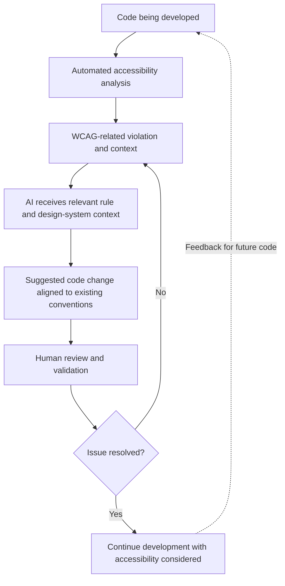

# Accessibility-First Engineering
## A case study in moving accessibility earlier in the development workflow

> **Scope and confidentiality:** This is a high-level, sanitized account of engineering work on an enterprise wealth-management application. It excludes proprietary source code, internal architecture, customer information, screenshots, and confidential design-system assets. The reported metrics and descriptions should be published only if approved for external disclosure.

## Executive summary

Accessibility work can become expensive when issues are discovered only after implementation. The workflow described here was designed to bring accessibility considerations closer to code creation, combining automated analysis, AI assistance grounded in relevant context, and human validation.

The principle behind the work is what I call an **accessibility-first mindset**: consider accessibility as code is created, rather than treating it only as a remediation step at the end.

## The problem

In a large web application, accessibility remediation can involve several repeated steps:

- Finding violations against applicable Web Content Accessibility Guidelines (WCAG) criteria.
- Understanding why a particular implementation fails and what needs to change.
- Implementing a fix that fits the application's existing components and design conventions.
- Validating that the violation has been addressed without introducing regressions.

Before this workflow, engineers could spend entire days fixing accessibility violations. Generic suggestions are not always sufficient in an enterprise application: a technically plausible fix may not fit the component patterns, styling conventions, or implementation constraints of the design system already in use.

The goal was to reduce that effort while making accessibility a more consistent part of development.

## Workflow at a glance

The following diagram describes the approach at a conceptual level, not the internal architecture of any company system.

The key is the context passed to the AI: not just “fix this accessibility issue,” but the relevant violation and the conventions of the application's existing design system. This helps make suggested changes more specific to the product instead of relying on generic patterns.

## Design approach

### 1. Identify WCAG-related violations

Automated analysis helps surface potential accessibility violations in web code, including HTML, CSS, and JavaScript. The findings provide a starting point for understanding the issue and the relevant accessibility requirement.

A detection result is a signal to investigate, not by itself proof that an experience is inaccessible in every context.

### 2. Ground AI assistance in relevant context

Rather than asking an AI system for a generic fix, the workflow provides context about the identified violation and the design-system conventions used by the application. This matters because accessibility remediation must work within the product's actual component and styling patterns—not just produce code that looks plausible in isolation.

This case study intentionally does not name internal systems or disclose proprietary design-system documentation, prompts, code, or architecture.

### 3. Keep fixes aligned with the existing design system

The workflow is specific to the design system used by the application at BNY. The intent is to suggest remediation that fits the components and conventions engineers already use, rather than treating the application as a generic web project.

That specificity is an important part of the approach: an accessibility fix should address the WCAG-related issue while remaining consistent with the product's established implementation patterns.

### 4. Validate with human judgment

AI-generated changes and automated checks still require review. Human validation helps assess whether the proposed fix is appropriate and whether the issue has actually been resolved.

### 5. Build an accessibility-first mindset

The workflow aims to shift the question from *“How do we fix these accessibility violations now?”* to *“How do we create code with accessibility in mind from the beginning?”*

## Reported impact

The measurements reported for this workflow were:

| Measure | Reported outcome |
| --- | --- |
| Time spent on accessibility work | Tasks that could previously take entire days were brought to under 30 minutes in the workflow. |
| Violation detection | The workflow was designed to identify approximately 85–90% of accessibility violations. |

**Interpret these measures carefully:** time depends on the task and comparison baseline. Detection coverage does not mean that the same percentage of issues were automatically fixed, nor that all remaining accessibility concerns were eliminated. Human validation remains important.

## My contribution

I designed and built the core workflow, bringing together automated accessibility analysis, AI assistance grounded in the relevant WCAG issue and BNY application's design-system context, and human validation. My focus was on making accessibility issues easier to surface and address, while encouraging accessibility to be considered earlier in development.

## What I learned

The key engineering lesson was that context matters. A generic AI suggestion may be syntactically reasonable but still conflict with the component patterns or design conventions of a real product. Grounding the suggestion in the relevant accessibility requirement and the design system makes the workflow more useful to engineers.

I also learned to keep distinct outcomes separate: how many issues a system detects, how much time a workflow saves, and whether a fix is genuinely correct are related but different questions.

## Limitations

Automated checks cannot establish that a product is accessible in every context. Some issues require judgment, manual testing, assistive-technology testing, or feedback from people with disabilities. The workflow should be treated as a way to improve coverage and efficiency—not as a replacement for inclusive design or comprehensive validation.

---

*This case study is intentionally conceptual and sanitized as the actual data I had worked on is highly confidential.*
